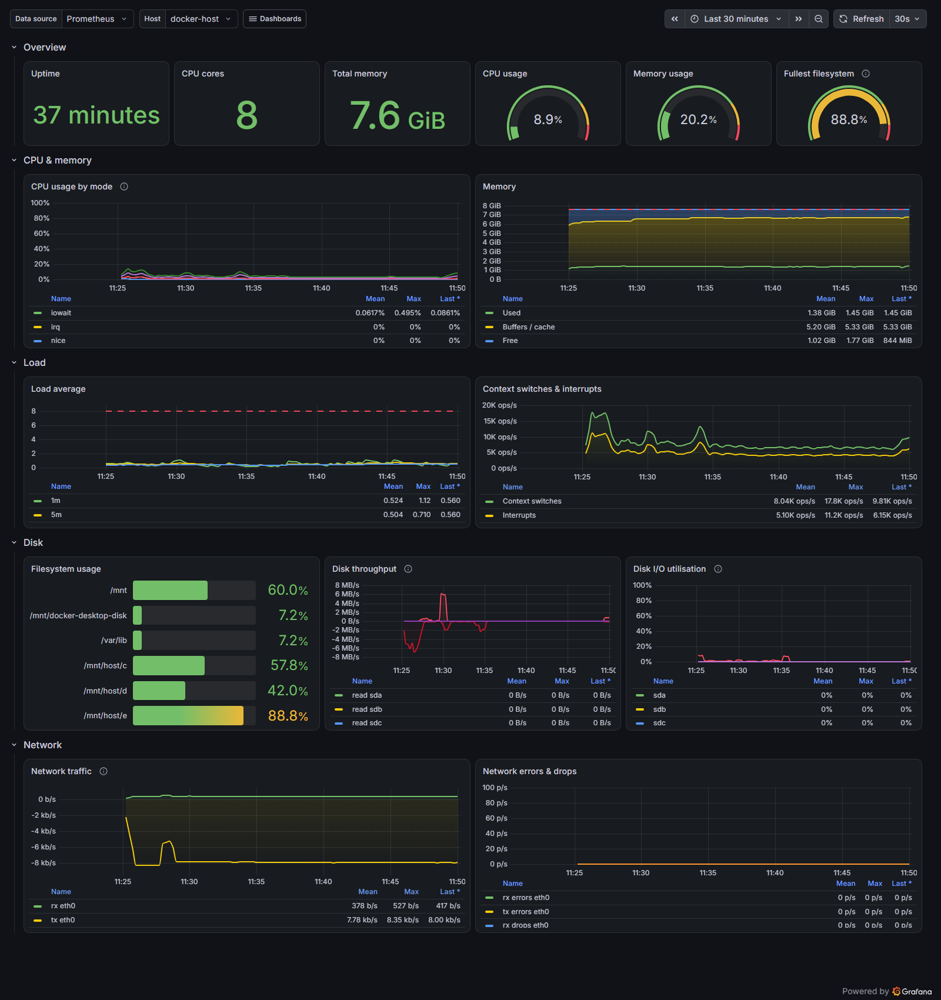
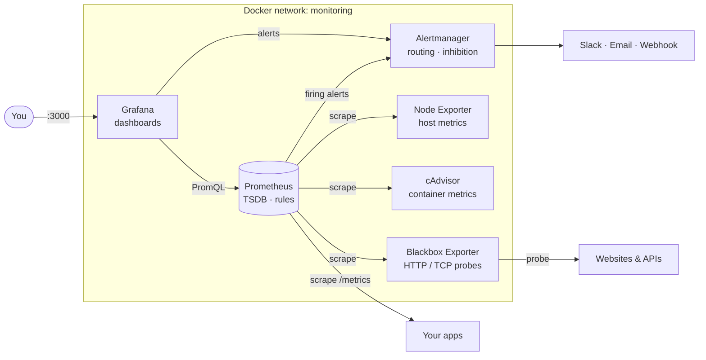
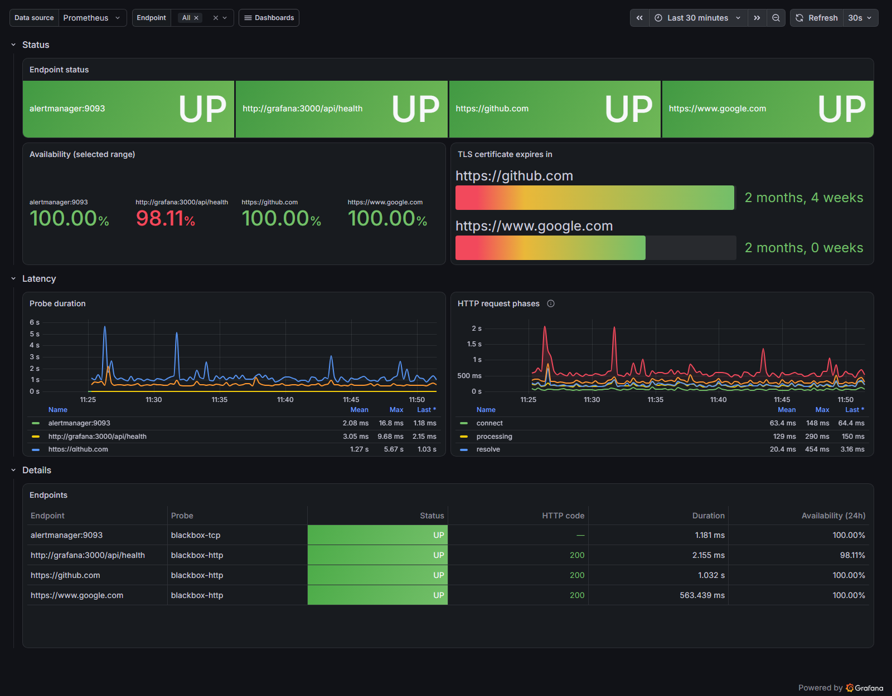
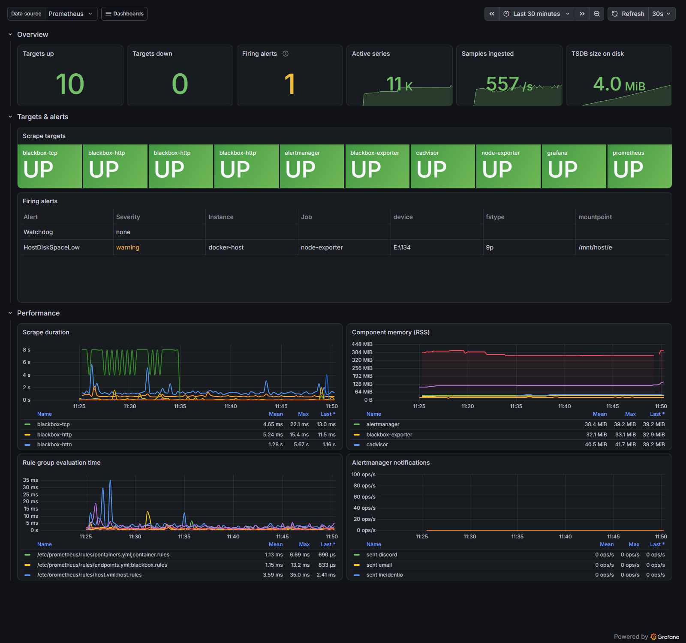

<div align="center">

# Docker Monitoring Stack

**Full observability for a Docker host in one command.**<br>
Metrics, dashboards, alerting and uptime checks with Prometheus, Grafana and Alertmanager.<br>
Configured as code, secure by default, and tested in CI on every commit.

[](https://github.com/anastanveer653/docker-monitoring-stack/actions/workflows/ci.yml)
[](LICENSE)


[Quick start](#quick-start) · [Dashboards](#dashboards) · [Alerts](#alerts) · [Configuration](#configuration) · [Runbooks](docs/runbooks.md) · [Changelog](CHANGELOG.md)



</div>

---

## Highlights

- **Up in one command.** `./scripts/start.sh` generates a `.env` with a random password, starts six services in dependency order, and waits until every healthcheck passes.
- **4 dashboards, provisioned as code.** Host, Docker containers, endpoint uptime and TLS expiry, and the health of the monitoring stack itself.
- **21 alerts, every one unit-tested.** Each alert has a [runbook](docs/runbooks.md) and [`promtool` unit tests](prometheus/tests/alerts_test.yml) that check it fires, when it fires, and what the message says. Many tests also check that it stays quiet for healthy targets. CI fails if an alert is added without a test or a runbook. The set includes a predictive alert (*disk full within 24h*) and a dead man's switch (`Watchdog`).
- **Secure by default.** UIs listen on `127.0.0.1` only, exporters are not published on the host, the Prometheus admin API is off, secrets are kept in files outside git, and every container has `no-new-privileges` and resource limits.
- **Tested in CI.** Every push runs ShellCheck, yamllint, `promtool`, `amtool` and the rule tests, then **starts the whole stack inside GitHub Actions** and runs end-to-end [smoke tests](scripts/smoke-test.sh).
- **Add targets without restarting.** Put a YAML file in `prometheus/targets/` and Prometheus picks it up within 30 seconds. Config changes are validated before they are hot-reloaded.

## Architecture



| Service | Version | Port | Role |
|---|---|---|---|
| [Prometheus](https://prometheus.io) | `v3.15.1` | `127.0.0.1:9090` | Metrics collection, storage, recording and alerting rules |
| [Grafana](https://grafana.com) | `13.3.0` | `127.0.0.1:3000` | Dashboards (Prometheus + Alertmanager datasources) |
| [Alertmanager](https://prometheus.io/docs/alerting/latest/alertmanager/) | `v0.34.2` | `127.0.0.1:9093` | Grouping, routing, inhibition and notification |
| [Node Exporter](https://github.com/prometheus/node_exporter) | `v1.12.1` | internal | Host CPU, memory, disk, network |
| [cAdvisor](https://github.com/google/cadvisor) | `v0.60.6` | internal | Per-container resource usage |
| [Blackbox Exporter](https://github.com/prometheus/blackbox_exporter) | `v0.29.1` | internal | HTTP/TCP probes, latency and TLS expiry |

## Quick start

**Requirements:** Docker Engine 24+ with the Compose v2 plugin, on Linux, macOS or Windows (Docker Desktop with WSL2).

```bash
git clone https://github.com/anastanveer653/docker-monitoring-stack.git
cd docker-monitoring-stack
./scripts/start.sh            # or: make up
```

Then open **<http://localhost:3000>** and log in as `admin`. The generated password is in `.env`:

```bash
grep GRAFANA_ADMIN_PASSWORD .env
```

| URL | What you get |
|---|---|
| <http://localhost:3000> | Grafana. The *Host Overview* dashboard is the home page. |
| <http://localhost:9090> | Prometheus: targets, rules, PromQL explorer |
| <http://localhost:9093> | Alertmanager: active alerts and silences |

## Dashboards

All dashboards are in the **Monitoring** folder and linked to each other from the *Dashboards* menu in the top-right corner.

| Dashboard | What it shows |
|---|---|
| **Host Overview** | Uptime, CPU, memory, fullest filesystem, CPU by mode, memory breakdown, load vs. cores, disk throughput and utilisation, network traffic and errors |
| **Docker Containers** | Running containers, per-container CPU, memory and network, OOM kills, a summary table with memory limits and uptime |
| **Endpoints & Uptime** | UP/DOWN status per endpoint, availability %, TLS certificate expiry, probe latency broken down by HTTP phase |
| **Monitoring Stack Health** | Scrape targets, firing alerts, active series, ingestion rate, TSDB size, rule evaluation time, Alertmanager notifications |

<table>
  <tr>
    <td></td>
    <td></td>
  </tr>
  <tr>
    <td align="center"><b>Endpoints & Uptime</b></td>
    <td align="center"><b>Monitoring Stack Health</b></td>
  </tr>
</table>

## Alerts

Alerts are defined in [`prometheus/rules/`](prometheus/rules). Each one has `summary`, `description` and `runbook_url` annotations. Warning and critical variants share an alert name, so a critical alert **inhibits** its own warning, and a `TargetDown` alert inhibits every other alert for the same instance.

| Group | Alert | Fires when | Severity |
|---|---|---|---|
| Host | `HostHighCpuUsage` | CPU > 85% for 10m / > 95% for 5m | warning / critical |
| | `HostHighMemoryUsage` | Memory > 85% for 5m / > 95% for 2m | warning / critical |
| | `HostDiskSpaceLow` | Writable filesystem > 80% / > 90% full | warning / critical |
| | `HostDiskWillFillIn24Hours` | `predict_linear` says the disk is full within 24h | warning |
| | `HostOutOfInodes` | < 10% inodes free | warning |
| | `HostHighLoad` | 5m load > 2 × CPU cores for 15m | warning |
| | `HostOomKillDetected` | Kernel OOM killer ran | warning |
| Containers | `ContainerDown` | A container that was running in the last 15m has disappeared | warning |
| | `ContainerHighCpuUsage` | > 80% of one core for 10m | warning |
| | `ContainerHighMemoryUsage` | > 85% of its memory limit (only containers that have a limit) | warning |
| | `ContainerOomKilled` | Container was OOM-killed | warning |
| Endpoints | `EndpointDown` | Probe failing for 2m | critical |
| | `EndpointSlowResponse` | Average probe duration > 2s | warning |
| | `SslCertificateExpiringSoon` | Certificate expires in < 14d / < 3d | warning / critical |
| Stack | `Watchdog` | Always fires. This is the heartbeat for a dead man's switch | none |
| | `TargetDown` | A scrape target is unreachable for 2m | critical |
| | `PrometheusConfigReloadFailed` | Prometheus rejected a config reload | warning |
| | `PrometheusRuleEvaluationFailures` | Rules fail to evaluate | critical |
| | `PrometheusAlertmanagerUnreachable` | Prometheus cannot reach Alertmanager | critical |
| | `AlertmanagerConfigReloadFailed` | Alertmanager rejected a config reload | warning |
| | `AlertmanagerNotificationsFailing` | Slack/email/webhook delivery failing | warning |

## Configuration

### Environment variables

Set in `.env`. Create it with `./scripts/setup.sh`, or copy [`.env.example`](.env.example).

| Variable | Default | Description |
|---|---|---|
| `GRAFANA_ADMIN_USER` | `admin` | Grafana admin user |
| `GRAFANA_ADMIN_PASSWORD` | *required* | Grafana admin password (`setup.sh` generates a random one) |
| `GRAFANA_ROOT_URL` | `http://localhost:3000` | Public URL of Grafana (set this behind a reverse proxy) |
| `BIND_ADDRESS` | `127.0.0.1` | Host interface for the UIs. Use `0.0.0.0` only behind a firewall or proxy |
| `PROMETHEUS_RETENTION_TIME` | `30d` | Delete samples older than this |
| `PROMETHEUS_RETENTION_SIZE` | `10GB` | Maximum size of the TSDB on disk |
| `PROMETHEUS_EXTERNAL_URL` | `http://localhost:9090` | Used in links that Prometheus generates |
| `ALERTMANAGER_EXTERNAL_URL` | `http://localhost:9093` | Used in links inside notifications |

### Monitor your own applications

Any service that exposes Prometheus metrics can be added **without a restart**. Create a file in `prometheus/targets/apps/`:

```yaml
# prometheus/targets/apps/my-api.yml
- targets: ["my-api:8080"]
  labels:
    service: my-api
    env: production
```

Connect the application container to the `monitoring` network so Prometheus can reach it:

```yaml
# In your application's docker-compose.yml
services:
  my-api:
    networks: [default, monitoring]
networks:
  monitoring:
    external: true
```

### Uptime and TLS checks

Add URLs to [`prometheus/targets/blackbox-http.yml`](prometheus/targets/blackbox-http.yml), or `host:port` pairs to [`blackbox-tcp.yml`](prometheus/targets/blackbox-tcp.yml). The *Endpoints & Uptime* dashboard and the `EndpointDown` and `SslCertificateExpiringSoon` alerts pick them up automatically.

### Notifications

Alertmanager does not read environment variables, so secrets are stored as files in the gitignored [`alertmanager/secrets/`](alertmanager/secrets) directory.

**Slack:**

```bash
printf '%s' 'https://hooks.slack.com/services/XXX/YYY/ZZZ' > alertmanager/secrets/slack-webhook-url
```

Uncomment the `slack_configs` blocks in [`alertmanager/alertmanager.yml`](alertmanager/alertmanager.yml), then run `./scripts/reload.sh`. Messages use the template in [`alertmanager/templates/slack.tmpl`](alertmanager/templates/slack.tmpl) and include a runbook link.

**Email:** fill in the `smtp_*` settings and `email_configs` in the same file. Store the SMTP password in `alertmanager/secrets/smtp-password`.

**Dead man's switch:** point the `watchdog` receiver at [Healthchecks.io](https://healthchecks.io) or a similar service. You will then be paged if the alerting pipeline itself stops working.

## Operations

| Task | Script | Make |
|---|---|---|
| Create `.env` with a random password | `./scripts/setup.sh` | `make setup` |
| Start and wait until healthy | `./scripts/start.sh` | `make up` |
| Stop (data volumes are kept) | `./scripts/stop.sh` | `make down` |
| Validate, then hot-reload Prometheus + Alertmanager | `./scripts/reload.sh` | `make reload` |
| Validate all config and run the rule unit tests | `./scripts/validate.sh` | `make validate` |
| End-to-end checks against the running stack | `./scripts/smoke-test.sh` | |
| Status and health | `docker compose ps` | `make ps` |
| Follow logs | `docker compose logs -f prometheus` | `make logs s=prometheus` |
| Delete everything, including data | `docker compose down -v` | `make clean` |

## Testing and CI

The [CI workflow](.github/workflows/ci.yml) runs three jobs on every push and pull request:

1. **Lint:** ShellCheck on all scripts, `yamllint --strict` on all YAML.
2. **Validate:** `docker compose config`, `promtool check config`, `promtool test rules` (unit tests for all 21 alerts), an alert coverage check (every alert must have a test and a runbook), `amtool check-config`, and checks on the dashboard JSON.
3. **Smoke test:** starts the full stack on a GitHub runner, then checks that every target is up, host and container metrics arrive, recording rules produce data, no rule group has errors, the `Watchdog` alert reaches Alertmanager, and Grafana has provisioned every dashboard and can query Prometheus.

Run the same checks locally. Docker is the only requirement, because every tool runs in a container pinned to the versions in `docker-compose.yml`:

```bash
./scripts/validate.sh
./scripts/smoke-test.sh   # against a running stack
```

Dependabot opens weekly pull requests to update the container images. CI tests each one before it is merged.

## Project structure

```
.
├── docker-compose.yml          # 6 services, healthchecks, limits, log rotation
├── .env.example                # All tunables, documented
├── Makefile                    # Shortcuts for the scripts below
├── prometheus/
│   ├── prometheus.yml          # Scrape jobs with file-based service discovery
│   ├── blackbox.yml            # Probe modules (HTTP GET/POST, TCP)
│   ├── rules/                  # recording, host, containers, endpoints, stack
│   ├── targets/                # Edit these to add targets (no restart needed)
│   └── tests/                  # promtool unit tests for the alerts
├── alertmanager/
│   ├── alertmanager.yml        # Routing tree, inhibition, receivers
│   ├── templates/              # Slack message template
│   └── secrets/                # Gitignored: webhook URLs, SMTP password
├── grafana/
│   ├── provisioning/           # Datasources + dashboard provider
│   └── dashboards/             # 4 dashboards as JSON
├── scripts/                    # setup, start, stop, reload, validate, smoke-test
├── docs/runbooks.md            # What to do when each alert fires
└── .github/                    # CI, Dependabot, issue and PR templates
```

## Going to production

This stack is a solid base for a single host. Before you put it on a server that is reachable from the internet:

- [ ] Put Grafana behind a reverse proxy with TLS (Traefik, Caddy or Nginx), and set `GRAFANA_ROOT_URL`.
- [ ] Keep `BIND_ADDRESS=127.0.0.1`. Prometheus and Alertmanager have no authentication of their own.
- [ ] Configure at least one notification receiver and the `watchdog` heartbeat.
- [ ] Size `PROMETHEUS_RETENTION_SIZE` for your disk, or set up `remote_write` to long-term storage (Thanos, Mimir, VictoriaMetrics).
- [ ] Back up the `grafana_data` volume if you create dashboards or users in the UI.

See [SECURITY.md](SECURITY.md) for the full security model.

## Troubleshooting

<details>
<summary><b>cAdvisor shows no containers, or fails to start</b></summary>

cAdvisor needs `privileged: true` and the Docker root at `/var/lib/docker`. If you use rootless Docker or a custom `data-root`, change the `/var/lib/docker` volume in `docker-compose.yml` to match.
</details>

<details>
<summary><b>Docker Desktop (macOS/Windows): the host metrics look unfamiliar</b></summary>

On Docker Desktop, Node Exporter runs inside Docker's Linux VM. It reports that VM's CPU and memory, and your host drives appear as mounts such as `/mnt/host/c`. This is expected. On a Linux server you see the real host.
</details>

<details>
<summary><b>My config change is not active</b></summary>

Run `./scripts/reload.sh`. It validates the config first and refuses to reload a broken file. If a reload failed earlier, the `PrometheusConfigReloadFailed` or `AlertmanagerConfigReloadFailed` alert fires.
</details>

<details>
<summary><b>A dashboard says "No data"</b></summary>

Open *Monitoring Stack Health*. If a target is red, Prometheus cannot scrape it, and `docker compose logs <service>` shows why. Panels that use `rate()` need about a minute of data after a fresh start.
</details>

## Roadmap

- [ ] Logs with Loki + Grafana Alloy (optional Compose profile)
- [ ] Traefik reverse proxy profile with automatic TLS
- [ ] SLO dashboards and multi-window burn-rate alerts
- [ ] Example application with custom metrics

## Contributing

Contributions are welcome. See [CONTRIBUTING.md](CONTRIBUTING.md) for the workflow and for how to add alerts and dashboards.

## License

[MIT](LICENSE) © [Anas Tanveer](https://github.com/anastanveer653)
